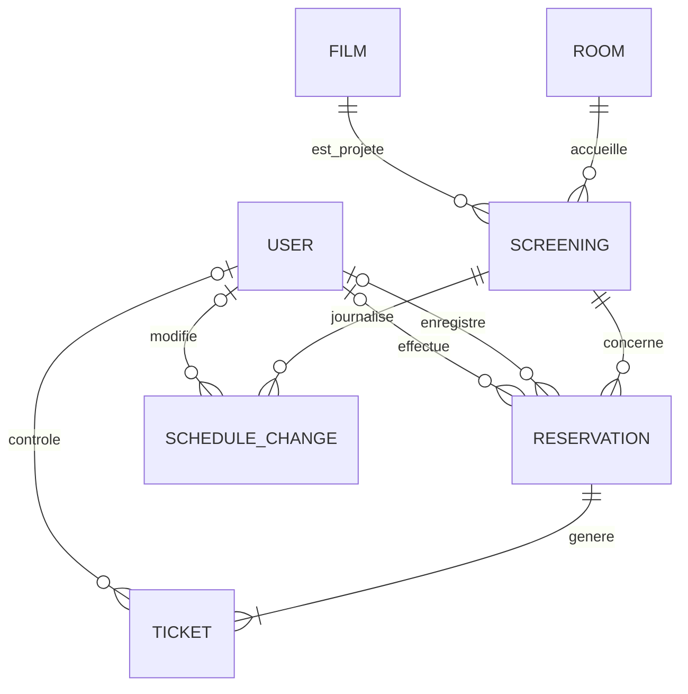

# Modèle de données

Les migrations Django définissent le schéma reproductible. Les places sont
en placement libre. Une place attribuée est représentée par un billet, rattaché
à une réservation inscrite sur une séance.

| Entité | Données principales |
| --- | --- |
| Utilisateur | Identifiant Django, groupes métier, mot de passe haché |
| Film | Titre, durée, genre, synopsis |
| Salle | Nom, format, capacité |
| Séance | Film, salle, début, fin, jauge, tarif, statut, révision |
| Réservation | Séance, client web éventuel, quantité, tarif unitaire enregistré, référence UUID, clé de demande unique, canal, état, échéance |
| Place attribuée / billet | Réservation, référence UUID, date et agent de validation |
| Modification de séance | Séance, état précédent et suivant, agent, horodatage, réservations concernées |

## Stock et concurrence

Le stock dépend des réservations réglées et de celles qui restent dans leur délai
de règlement. La même règle alimente la disponibilité publique, les ventes
au guichet et le tableau de bord. Une expiration ou une annulation fait sortir
la ligne de l’ensemble comptabilisé. La libération ne dépend donc pas d’un
compteur à décrémenter ou à réincrémenter.

### Bug potentiel de dernière place

Sans transaction avec verrou, un spectateur et un agent de guichet peuvent lire
chacun une disponibilité de 1, puis confirmer chacun un billet. Sur PostgreSQL,
toute opération sur les places commence par verrouiller la séance. La première
transaction valide et crée réservation et billets ensemble. La deuxième recalcule
la disponibilité après le verrou et reçoit un refus si elle est arrivée trop tard.
Le test `test_desk_and_web_compete_for_last_place` déclenche les deux opérations
en parallèle avec deux connexions PostgreSQL.

Une clé de demande UUID unique permet à un même utilisateur de réessayer le
même achat après une interruption. Le changement de quantité ou de séance avec
la même clé est refusé. À l’entrée, le verrou sur la séance rend la vérification
et le marquage du billet indivisibles.

Les groupes Django filtrent les écrans métier côté serveur. Les billets des
spectateurs sont accessibles au compte qui a réservé et au guichet. Le QR
contient la référence du billet. Le personnel valide cette référence dans une
séance sélectionnée, après vérification du statut de règlement et d’utilisation.

## Hypothèses du pilote

Règlement en caisse dédiée, au plus tard 15 minutes avant la séance. Le tarif
enregistré à la réservation reste celui dû par le spectateur. Les annulations
sont enregistrées au guichet tant que la séance n’a pas commencé et qu’aucun
billet associé n’a été utilisé. Les éventuels remboursements sont effectués
sur place. Le tableau signale les séances à partir de 90 % de places attribuées.
